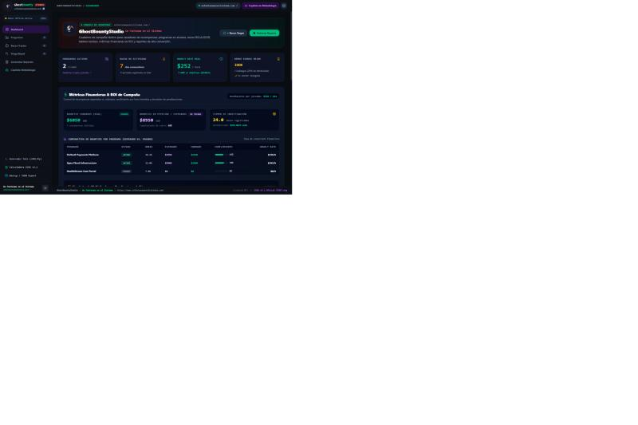
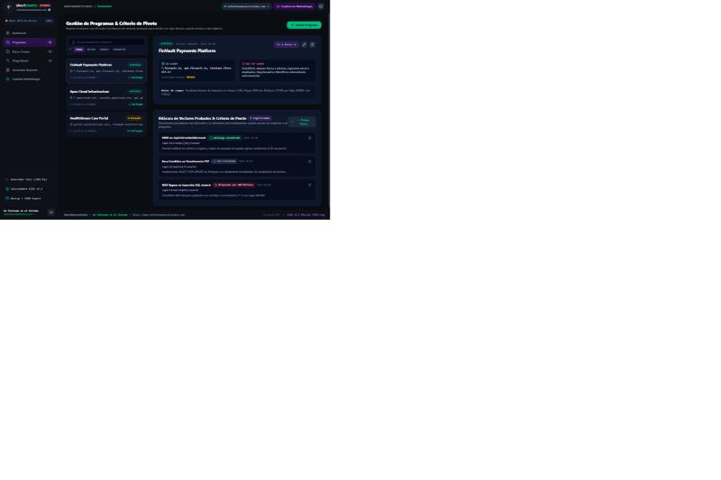
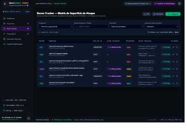
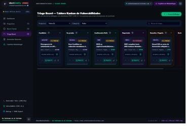
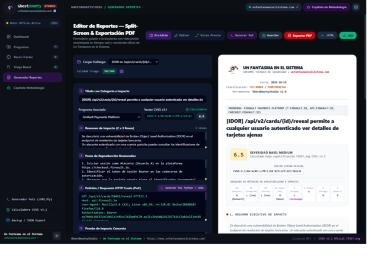
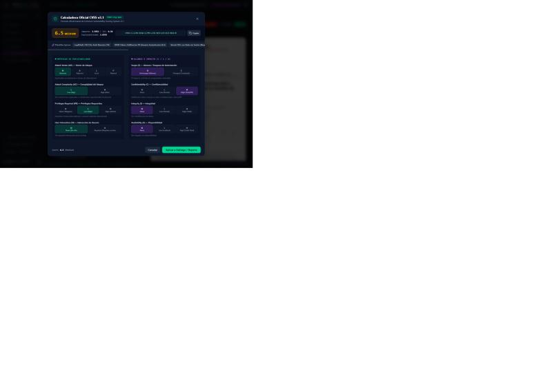

# 👻 GhostBountyStudio

> **Cuaderno de Campaña Interactivo, Consola de Reconocimiento y Generador de Informes de Bug Bounty**  
> Creado por [Un Fantasma en el Sistema](https://unfantasmaenelsistema.com).

[]()
[]()
[]()
[]()
[]()
[](LICENSE)

---

## 📌 ¿Qué es GhostBountyStudio?

**GhostBountyStudio** es una suite integral y moderna diseñada específicamente para cazadores de recompensas (*Bug Bounty Hunters*) e investigadores de ciberseguridad. Proporciona una interfaz unificada y de alta productividad para registrar objetivos, mapear superficies de ataque, calcular matrices de impacto oficiales, generar scripts de prueba de concepto (PoC) y exportar reportes de vulnerabilidad con estándar de auditoría y membrete oficial.

Todo el procesamiento ocurre **100% en el navegador del usuario (Client-Side)** mediante `localStorage`, garantizando total privacidad sobre programas privados, activos confidenciales y hallazgos no divulgados.

---

## 📸 Vista de la Plataforma y Módulos

**Demo en vivo:** [unfantasmaenelsistema.github.io/GhostBountyStudio](https://unfantasmaenelsistema.github.io/GhostBountyStudio/)

<table>
<tr>
<td align="center"><b>Dashboard de campaña y ROI</b><br></td>
<td align="center"><b>Programas y criterio de pivote</b><br></td>
</tr>
<tr>
<td align="center"><b>Recon Tracker</b><br></td>
<td align="center"><b>Triage Board (Kanban)</b><br></td>
</tr>
<tr>
<td align="center"><b>Editor de reportes (split-screen)</b><br></td>
<td align="center"><b>Calculadora oficial CVSS v3.1</b><br></td>
</tr>
</table>

### 1. 📊 Dashboard de Campaña y Calculadora Financiera de ROI
- **Métricas de Recompensas:** Comparativa en tiempo real de recompensas esperadas vs. pagadas (*Payout Efficiency Ratio*).
- **Hourly Rate Real:** Cálculo automático de la tasa de pago por hora/jornada invertida según la severidad.
- **Gráficos de Severidad:** Distribución visual de hallazgos (Crítico, Alto, Medio, Bajo).

### 2. 📝 Editor de Reportes en Dos Columnas (Split-Screen)
- **Doble Columna:** Formulario editable con autoguardado a la izquierda y renderizado en vivo a la derecha.
- **Membrete Oficial:** Encabezado formal de *Un Fantasma en el Sistema* con metadatos de auditoría, CVE, CWE y fecha.
- **Tabla Oficial CVSS v3.1:** Vector desglosado según los estándares de FIRST.org (AV, AC, PR, UI, S, C, I, A).
- **Exportación Versátil:** Descarga en PDF limpio listo para imprimir (con `@media print` optimizado para A4), descarga en HTML autónomo y copia en formato Markdown.

### 3. 💻 Generador de PoCs en Python y cURL
- **Parser de Peticiones HTTP Crudas:** Pega directamente el tráfico HTTP capturado desde **Burp Suite** o **OWASP ZAP**.
- **Generación Automática de Scripts:**
  - Script en **Python 3 (`requests`)** con cabeceras, cookies, métodos y payloads formateados.
  - Comando listo para terminal en **cURL**.
- **Inyección Rápida:** Copia con un clic, descarga el script `.py` o insértalo de inmediato en el borrador de tu reporte.

### 4. ⚡ Calculadora Oficial CVSS v3.1 Modal
- Calculadora interactiva completa con métricas Base de FIRST.org.
- Cálculo de puntuación (0.0 - 10.0) y severidad (Ninguna, Baja, Media, Alta, Crítica) en tiempo real con generación de vector estándar (`CVSS:3.1/AV:N/AC:L/...`).

### 5. 🌐 Recon Tracker & Superficie de Ataque
- Registro de subdominios, puertos abiertos, tecnologías detectadas, parámetros interesantes y endpoints sensibles.
- Filtros por estado (Vivo, Pendiente, Descartado) e importación/exportación rápida.

### 6. 📋 Triage Board (Kanban de Hallazgos)
- Gestión del ciclo de vida de vulnerabilidades: *Identificado*, *Validado*, *Reportado*, *Triaged*, *Resuelto* y *Duplicado/Out-of-Scope*.
- Control de tiempos de respuesta del equipo de seguridad y seguimiento de pagos.

### 7. 🧠 Copiloto de Metodología y Checklist
- Guías paso a paso para vulnerabilidades OWASP Top 10 / Web (IDOR, SSRF, SQLi, XSS, OAuth Misconfigurations, Race Conditions, Subdomain Takeover).
- Checklist de verificación pre-reporte para evitar rechazos por *Informative* o *Not Applicable*.

---

## 🚀 Despliegue en GitHub Pages

Ya está desplegada y en vivo: **[unfantasmaenelsistema.github.io/GhostBountyStudio](https://unfantasmaenelsistema.github.io/GhostBountyStudio/)**, vía `.github/workflows/deploy.yml` (GitHub Actions + GitHub Pages, origen "GitHub Actions"). El workflow usa **Bun**, no npm/Node — el `package.json` original (`vite@8` + `esbuild@0.25` como devDependency fijada) tiene un conflicto real de peer-dependencies que npm bloquea y Bun resuelve sin problema; por eso el repo lleva `bun.lock` commiteado en vez de `package-lock.json`.

### Si haces un fork o clonas este repo para tu propia instancia

1. **Instala dependencias y compila con Bun** (no uses `npm install`/`npm ci`, fallará):
   ```bash
   bun install
   bun run build
   ```
2. **Sube tu copia a tu propio repositorio:**
   ```bash
   git remote set-url origin https://github.com/TU-USUARIO/TU-REPOSITORIO.git
   git push -u origin main
   ```
3. En GitHub, ve a **Settings** → **Pages** → **Build and deployment** → **Source** → **GitHub Actions**.
4. El workflow ya incluido (`oven-sh/setup-bun` + `bun install --frozen-lockfile` + `bun run build`) se encarga del resto. Tu copia quedará disponible en:
   `https://TU-USUARIO.github.io/TU-REPOSITORIO/`

### Despliegue manual a cualquier hosting estático

```bash
bun install
bun run build
# dist/ contiene la web estática: sirve igual en GitHub Pages, Vercel, Netlify, Cloudflare Pages o S3.
```

---

## 🛠️ Tecnologías Utilizadas

- **Core:** [React 19](https://react.dev/), [TypeScript](https://www.typescriptlang.org/)
- **Bundler:** [Vite 8](https://vitejs.dev/) (con `base: './'` para compatibilidad con rutas relativas de GitHub Pages)
- **Estilos:** [Tailwind CSS v4](https://tailwindcss.com/)
- **Iconografía:** [Lucide Icons](https://lucide.dev/)
- **Almacenamiento:** Navegador Web (`localStorage` y exportaciones JSON de backup)

---

## 🔒 Privacidad y Seguridad de Datos

- **Zero-Telemetry:** No se recopilan estadísticas, métricas ni telemetría.
- **Sin base de datos remota no autorizada:** Todos los programas, activos y credenciales de prueba se guardan únicamente en tu navegador.
- **Exportación & Backup:** Dispones de una herramienta integrada para descargar todos tus datos en un archivo JSON encriptable y restaurarlo cuando cambies de equipo.

---

## 📄 Licencia

Licencia MIT — ver [`LICENSE`](LICENSE). Desarrollado con dedicación para la comunidad de seguridad y hacking ético por **Un Fantasma en el Sistema**.  
Consulta el sitio web oficial: [unfantasmaenelsistema.com](https://unfantasmaenelsistema.com).
